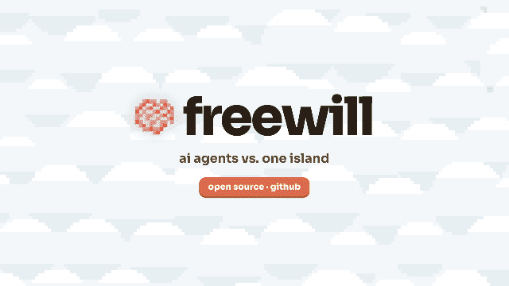
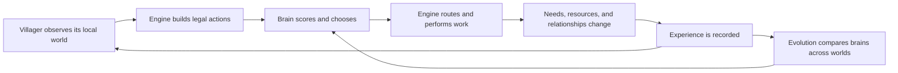

# Freewill Simulation

I put a bunch of AI villagers into an empty world to see what they would do.

Each villager has needs, traits, memories, relationships, and an evolving brain. The brain chooses what the villager should try to do; the simulation handles walking, time, resources, work, failure, and consequences. Sometimes they cooperate. Sometimes they build. Sometimes everybody ignores the food and dies.

[Try the live project](https://freewill-drab.vercel.app) · [Read the documentation](docs/README.md) · [See the roadmap](ROADMAP.md)



> **Alpha software:** Freewill is a playable research side project, not a finished game or a claim that these agents are conscious. Simulation rules, brain contracts, and save formats will continue to evolve.

## What is Freewill?

Freewill is an open-ended AI society simulation. A generated world starts with 3–100 empty-handed people, finite terrain, natural resources, and no assigned jobs, government, currency, or shared objective.

Villagers can:

- forage, gather, fish, hunt, grow crops, cook, and store food;
- make tools, build shelters, roads, wells, workshops, and public projects;
- request, share, barter, steal, teach, rescue, promise, forgive, or retaliate;
- develop skills, occupations, relationships, households, groups, and institutions;
- remember consequences and make new decisions from their own local knowledge;
- fail, collapse, recover, or permanently die.

The interesting part is not that every world becomes a civilization. It is that the same physical rules can produce different outcomes depending on the villagers, their experiences, and the decisions their brains make.

## Run it

### Complete Docker stack

Requirements: Docker Desktop, or Docker Engine with Compose.

After cloning the repository:

```bash
cd freewill-simulation
cp .env.example .env
docker compose up -d --build
```

Open:

- Game: <http://localhost:5173>
- Database dashboard: <http://localhost:8080>
- App readiness: <http://localhost:5173/api/health/ready>
- Local brain health: <http://127.0.0.1:8008/v1/health>

No API key is required. The complete decision system runs locally.

See [Docker setup](docs/getting-started/docker.md), [configuration](docs/getting-started/configuration.md), and [troubleshooting](docs/getting-started/troubleshooting.md).

### Local development

Requirements: Node.js 22+ and pnpm 11.25.0.

```bash
pnpm install
pnpm dev
```

Without `DATABASE_URL`, the browser automatically uses IndexedDB for world storage. The Python brain service and PostgreSQL are optional during ordinary UI development.

## How it works



The simulation is authoritative. A provider cannot invent resources, teleport a villager, complete a building, or write directly to world state. It receives opaque legal candidate IDs, chooses one, and the engine validates it again before execution.

Walking and work are animated and time-consuming, but the brain does not choose every movement frame. It chooses high-level intentions such as “gather wood from this tree,” while deterministic routing and action systems execute the plan.

[How Freewill works](docs/concepts/how-freewill-works.md) explains the complete loop in plain language.

## Decision modes

| Mode | Purpose | Network required |
| --- | --- | --- |
| Local evolving brains | CPU-only sparse recurrent policies trained through mutation and selection | No |
| Local lab | Deterministic offline control and reproducible debugging | No |
Brain-service failures remain visible. Freewill never silently changes the selected experimental condition.

## Evolving brains

The local brain service uses a shared sparse neural backbone, an individual genome/embedding, and recurrent lifetime memory. Experiments evaluate populations across multiple seeded worlds, preserve every generation, mutate descendants, and validate them on held-out worlds.

The evolution observatory shows:

- the real world state and citizen routes;
- genuine legal candidates and scores;
- needs, inventory, relationships, memories, and commitments;
- brain lineage, mutations, rewards, and generation comparisons;
- replayable checkpoints from completed and running episodes.

Start with [Local evolving brains](docs/providers/local-evolving-brains.md) and [Running an experiment](docs/experiments/running-an-experiment.md).

## Architecture

```text
React interface ──────────────┐
                              ▼
Canvas renderer ◄── snapshots ── deterministic TypeScript simulation
                                      │
                              legal decision contract
                              ┌───────┴───────┐
                              ▼               ▼
                         local brain      Local lab
                              │
                            server
                                      │
                               PostgreSQL / replay
```

Important boundaries:

- `src/sim/` owns deterministic world rules, decisions, actions, and consequences.
- `src/renderer/` turns snapshots into an animated Canvas2D world; it cannot mutate gameplay.
- `src/features/` contains experiments, the observatory, and Creator Studio.
- `src/persistence/` validates and stores versioned world documents.
- `server/` hosts the production app, migrations, world APIs, and local brain gateway.
- `services/brain/` is the CPU-only Python/PyTorch decision and evolution service.
- `public/little-worlds/` contains only the procedural runtime used by the renderer.

Read the [architecture overview](docs/architecture/overview.md) for the full system map.

## Documentation

The complete documentation is indexed at [`docs/README.md`](docs/README.md).

- [Getting started](docs/getting-started/docker.md)
- [Simulation concepts](docs/concepts/how-freewill-works.md)
- [Architecture](docs/architecture/overview.md)
- [World systems](docs/world/README.md)
- [Evolution experiments](docs/experiments/README.md)
- [Decision policies](docs/providers/README.md)
- [Operations](docs/operations/README.md)
- [Technical reference](docs/reference/README.md)
- [Implementation status](docs/project/status.md)

## Development

```bash
pnpm typecheck
pnpm test
pnpm build
pnpm test:e2e
```

Optional measured benchmarks:

```bash
pnpm benchmark
pnpm benchmark:phase1
pnpm benchmark:browser
```

Read [CONTRIBUTING.md](CONTRIBUTING.md) before changing simulation contracts or persisted state.

## Current limits

- The included stack is intended for one local operator. A public multi-user host still needs authentication, world ownership, rate limiting, and isolated workloads.
- Historical replay is read-only and cannot branch from a past tick.
- Evolution is CPU-first and deliberately small enough for ordinary laptops; it is not a distributed training platform.
- External models choose only from engine-generated legal actions and are limited by provider availability and cost.
- The initial action and production catalog proves the system rather than trying to model every part of human life.

See [ROADMAP.md](ROADMAP.md) for planned work and explicit non-goals.

## License

Freewill is available under the [MIT License](LICENSE).

